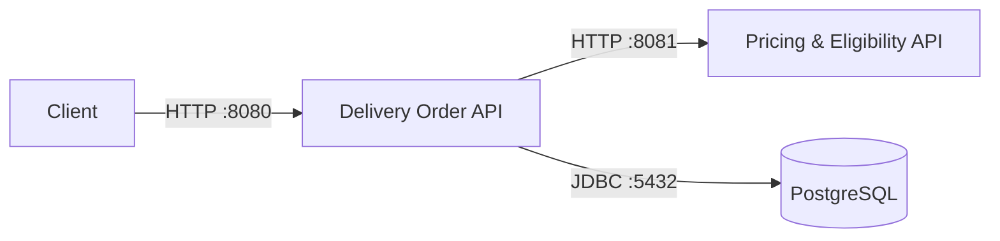

# Architecture

Delivery Order and Pricing & Eligibility are separate Java 21 and Spring Boot applications. Each has its own Maven wrapper, POM, and Dockerfile. The root Compose file starts both services and PostgreSQL.

## Package structure

Delivery Order uses `controller` for HTTP, `service` for order coordination, and `repository` for PostgreSQL access. Its `pricing` package holds the HTTP client for Pricing & Eligibility.

Pricing & Eligibility uses `controller` for HTTP and `service` for eligibility and price calculation. The service is stateless.

## Planned request flow

Delivery Order validates the request and binds its idempotency key. It calls Pricing over HTTP outside a database transaction. Pricing evaluates eligibility and calculates a quote. Delivery Order stores the confirmed price and currency with the order. Later reads return that stored snapshot, including when Pricing is unavailable.

Pricing is stateless. Delivery Order owns the database schema and migrations.

The Maven builds, Compose wiring, and Actuator endpoints are in place. The request flow above describes the planned business implementation.

See [decision records](decisions/), [API contracts](openapi/), and [deployment improvements](improvements/).
