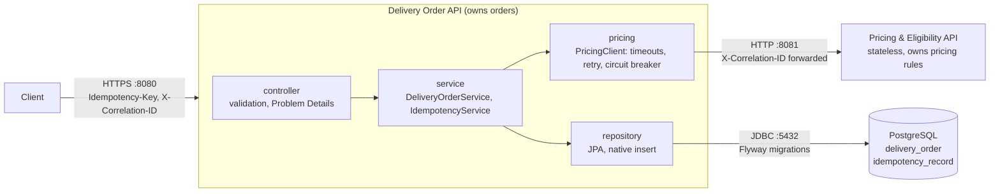
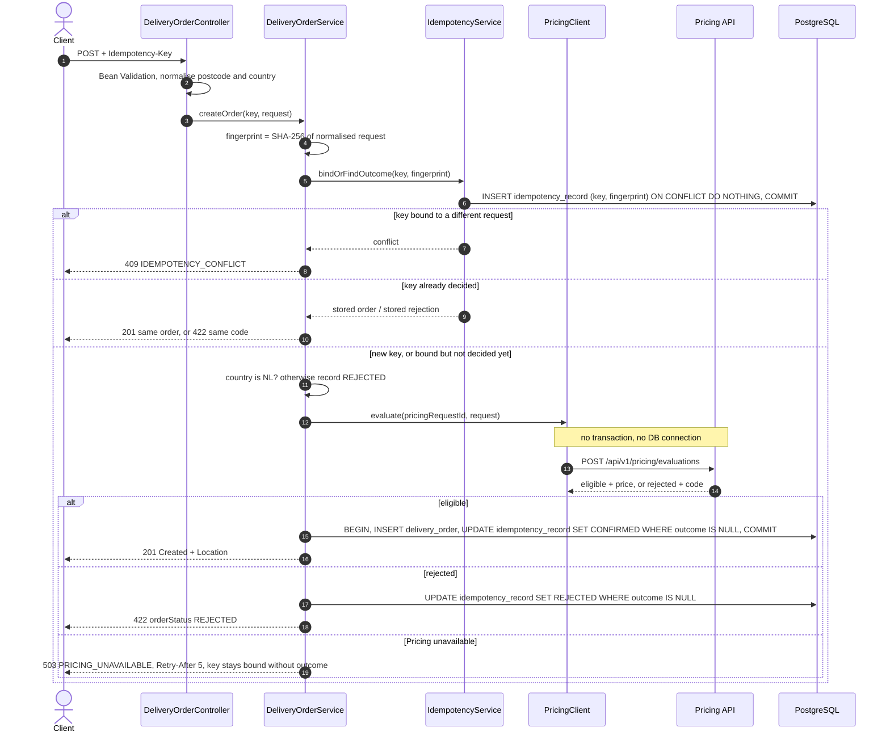
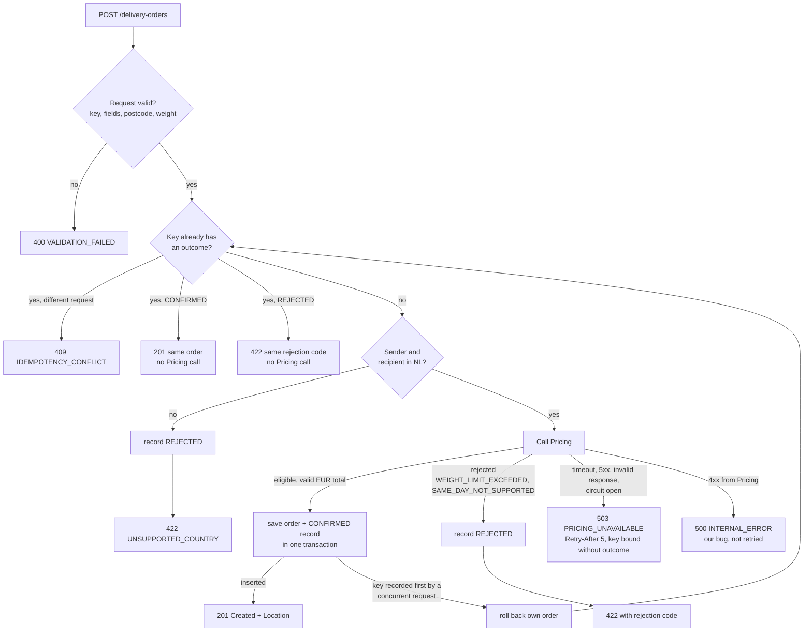
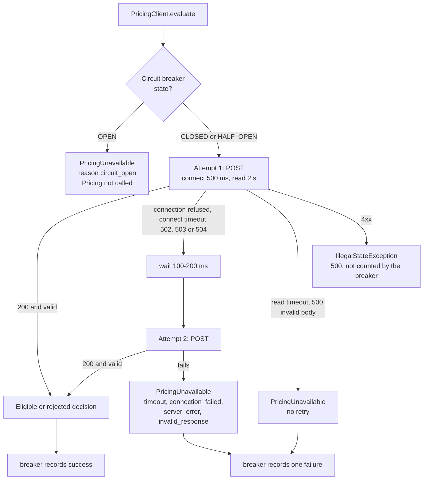
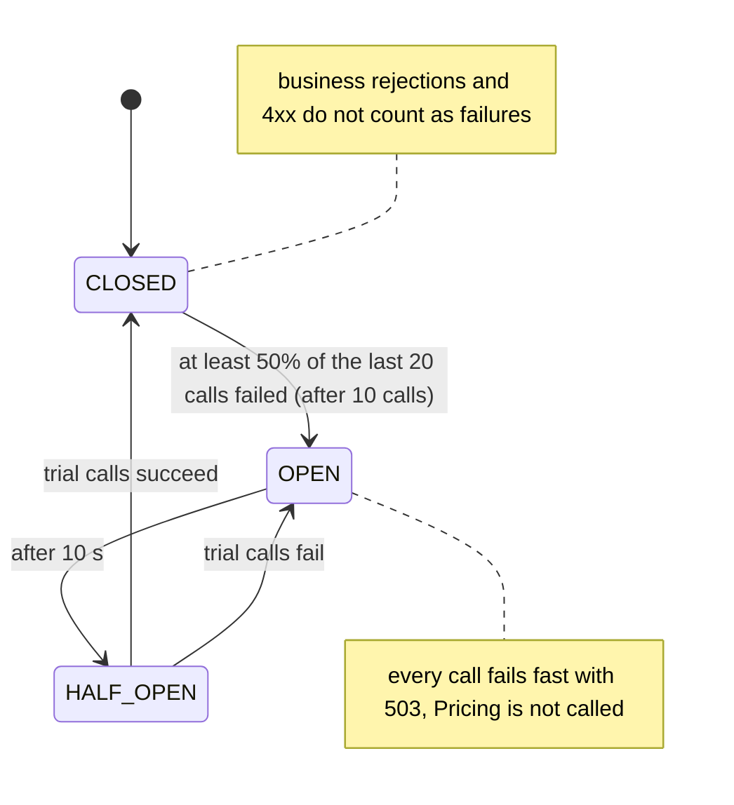
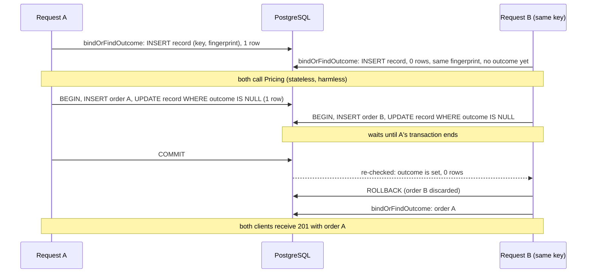
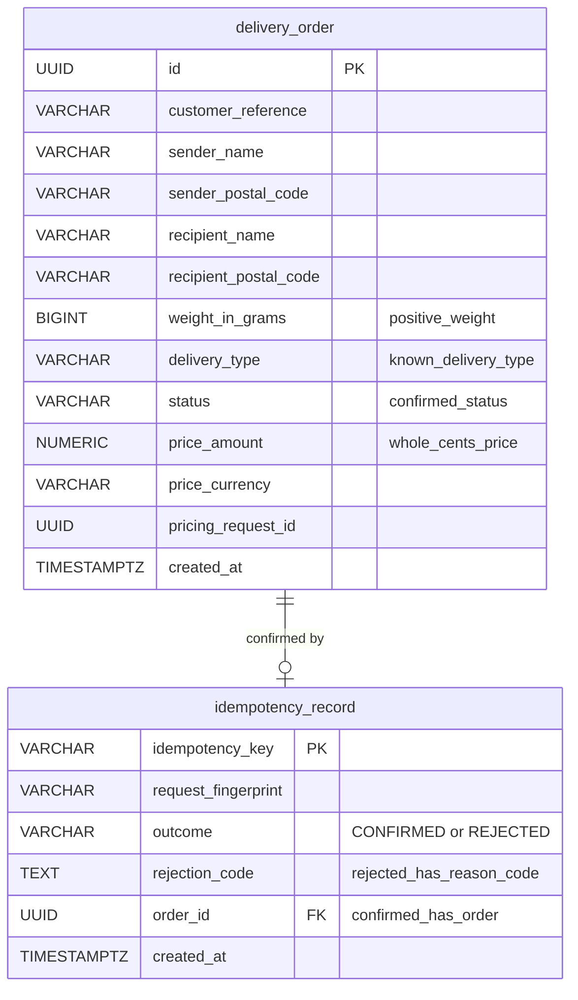

# Architecture

Delivery Order and Pricing & Eligibility are separate Java 21 / Spring Boot applications. Each has its own Maven
wrapper, POM, Dockerfile and OpenAPI contract (`docs/openapi/`), and they share no code or database. The root Compose
file starts both services and PostgreSQL.

## System overview

- **Delivery Order** owns orders and the database. It stores the confirmed price, so later tariff changes never alter
  historical orders, and GET never calls Pricing.
- **Pricing & Eligibility** is stateless: eligibility rules and price rules are pluggable beans (ADR-003).
- Requests run on virtual threads; no transaction or database connection is held while Pricing is called (ADR-007).

## Create an order: POST /api/v1/delivery-orders

## Business scenarios

| Scenario | Response | Stored |
| --- | --- | --- |
| Eligible delivery | 201 with order, `Location` | order + `CONFIRMED` record |
| Same request, same key again | 201 with the same order | nothing new; Pricing not called |
| Same key, different request | 409 `IDEMPOTENCY_CONFLICT` | nothing |
| Weight over 20 kg / same-day outside one postcode area | 422 `WEIGHT_LIMIT_EXCEEDED` / `SAME_DAY_NOT_SUPPORTED` | `REJECTED` record |
| Country other than NL | 422 `UNSUPPORTED_COUNTRY` (Pricing not called) | `REJECTED` record |
| Invalid input (postcode, weight ≤ 0, missing key, unknown delivery type) | 400 `VALIDATION_FAILED` | nothing |
| Pricing timeout, 5xx, invalid response or circuit open | 503 `PRICING_UNAVAILABLE`, `Retry-After: 5` | the key stays bound to the request, without an outcome: the same request can retry; a different request with that key gets 409 |
| Concurrent requests with one key | all get the outcome of the first one recorded | one order, one record |
| GET unknown order / invalid ID | 404 `ORDER_NOT_FOUND` / 400 | — |

Errors use RFC 9457 Problem Details with a `code`, the `correlationId`, and `orderStatus` for 422 and 503 (ADR-004).

## Calling Pricing: timeouts, retry and circuit breaker

`PricingClient` wraps each call as `CircuitBreaker( Retry( post + validate ) )`.

- **Timeouts:** connect 500 ms, read 2 s (normal Pricing latency 50–150 ms; 2–5 s counts as unavailable).
- **Retry:** at most one extra attempt, only when the request did not reach Pricing or Pricing answered 502/503/504.
  Read timeouts and 500 are not retried; validation failures and business rejections are never retried.
- **Response check:** `requestId` must match, `eligible` must be a boolean, the total must be EUR, ≥ 0 and have at
  most two decimals. Anything else is `invalid_response`.
- **Circuit breaker:** because retry is inside it, one call counts once, however many attempts it made.

## Concurrent requests with the same key

No locks are used in the application (ADR-0001, ADR-0010). The primary key on `idempotency_record.idempotency_key`
binds each key to one request, and the conditional update `WHERE outcome IS NULL` lets exactly one request decide it:
a second update of the same key waits for the first to commit, and PostgreSQL then re-checks the condition.

## Read an order: GET /api/v1/delivery-orders/{orderId}

Reads the stored order from PostgreSQL and never calls Pricing, so it works while Pricing is down and always shows the
price that was confirmed. `createdAt` is stored in UTC and returned with the Europe/Amsterdam offset.

## Data model

## Observability

- `X-Correlation-ID` is read or generated per request, put in the MDC, returned, and forwarded to Pricing. It is the
  business-facing ID a client can quote.
- Micrometer Tracing (OpenTelemetry bridge) adds `traceId` and `spanId` to every log line and sends the W3C
  `traceparent` header to Pricing, so one order has one trace ID in both services and a span ID per step. An incoming
  `traceparent` is continued. Spans are not exported yet; add an exporter (for example OTLP) to see them in a tracing
  backend.
- Structured `event` log fields: `order.created`, `order.rejected`, `order.pricing_unavailable`,
  `order.previous_outcome_returned`, `order.idempotency_conflict`, `pricing.call_failed`, `pricing.call_retry`,
  `pricing.circuit_state_changed`. Names, postcodes and request bodies are never logged.
- Actuator: `/actuator/health`, `/actuator/info`, `/actuator/metrics`.

See [decision records](decisions/), [API contracts](openapi/), [deployment improvements](improvements/deployment.md), and [idempotency record retention](improvements/idempotency-record-retention.md).
